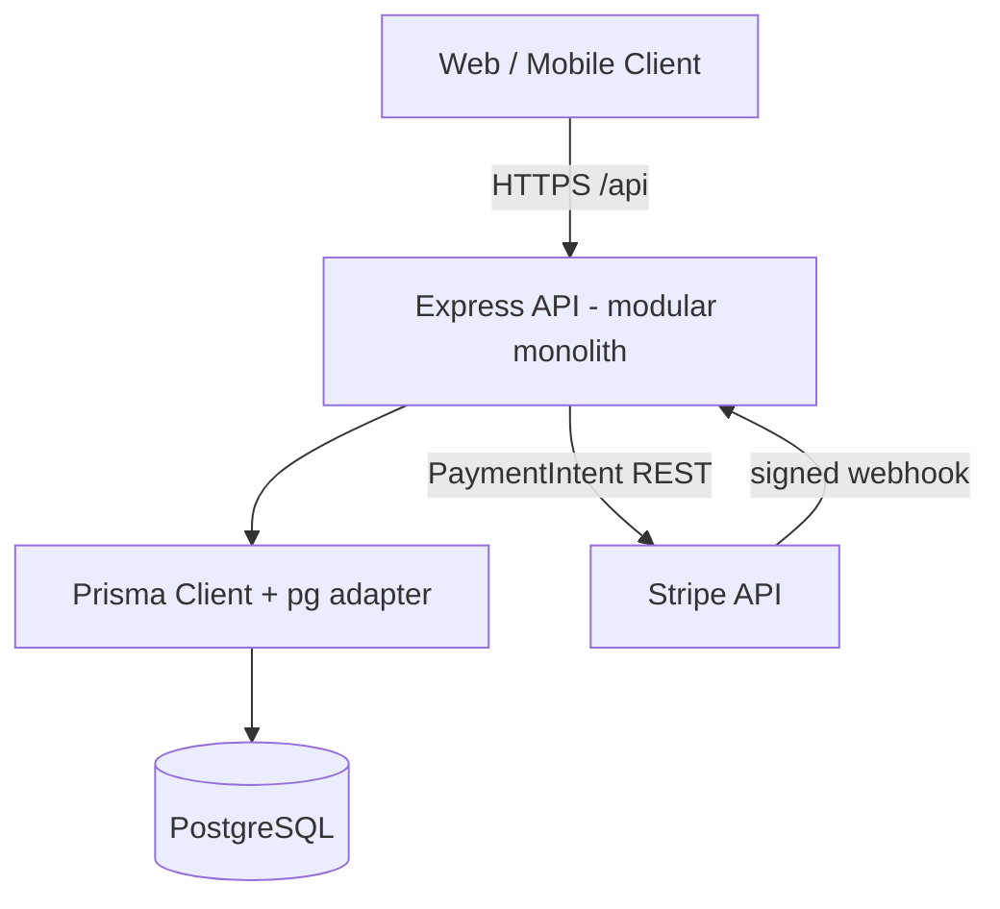
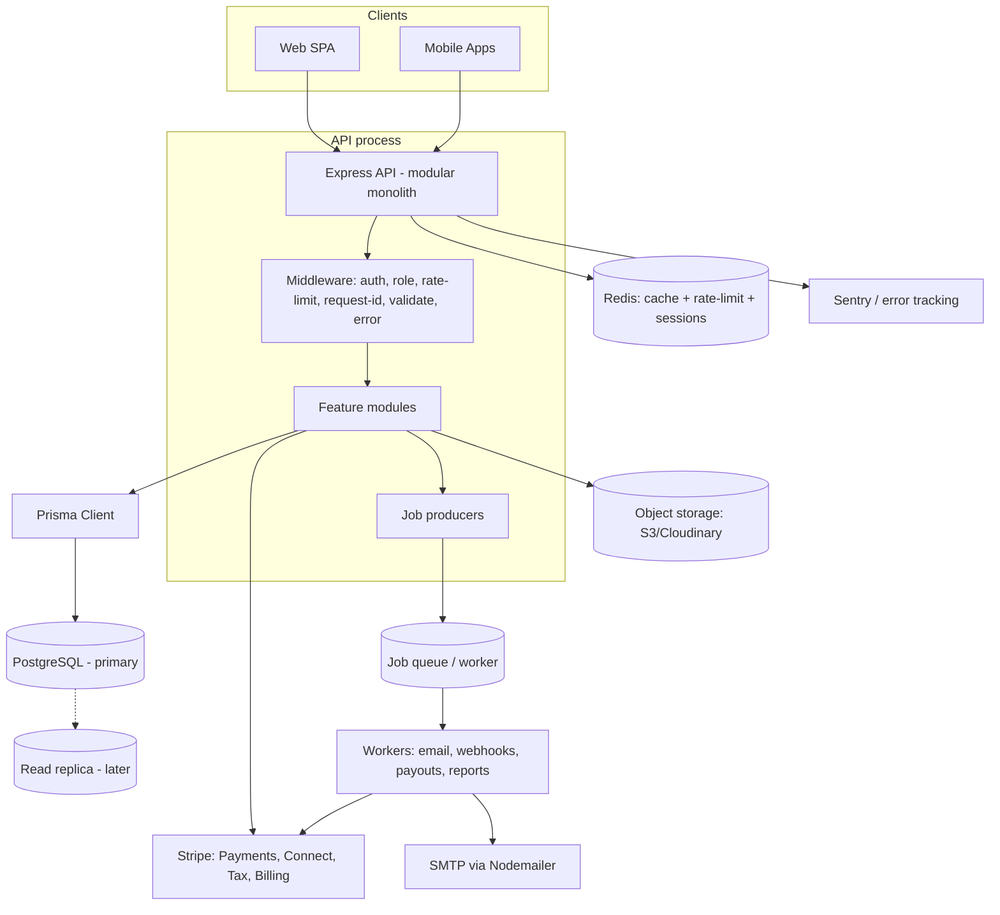
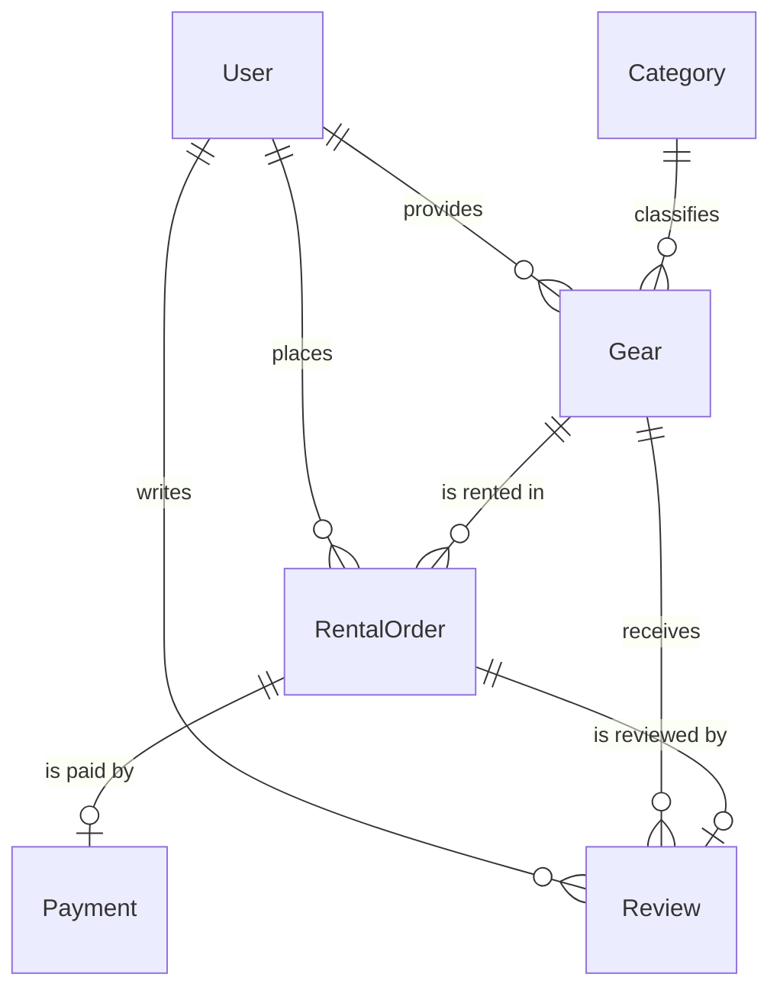
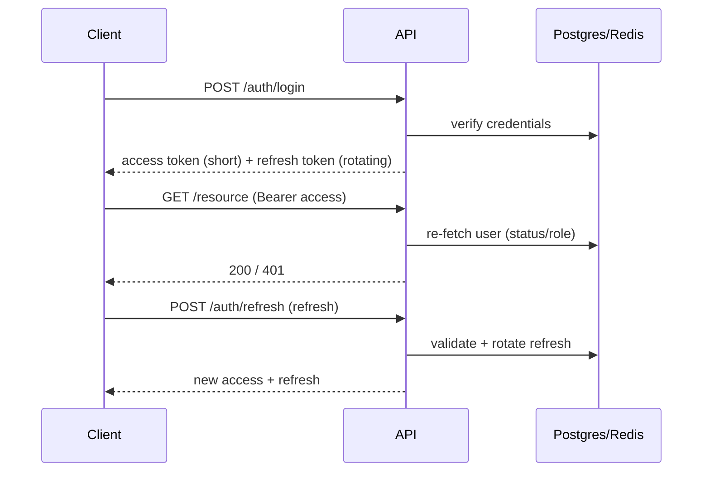
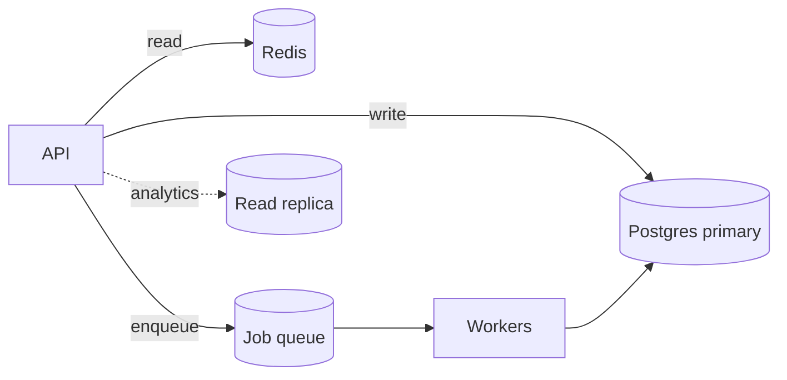

# GearUp — Architecture Document

> **Product:** GearUp — Sports & Outdoor Gear Rental Marketplace (Backend / API Platform)
> **Document status:** Draft v1.0 — for review
> **Prepared by:** Senior Software Architect
> **Date:** 2026-10-13
> **Sources:** `docs/PROJECT_ANALYSIS.md` (code-verified), `docs/PRD.md`, and the repository (`src/**`, `prisma/schema.prisma`, migrations, config)

**How to read this document**

| Tag | Meaning |
|---|---|
| **Current** | Exists in the codebase today (verified) |
| **Proposed** | Recommended target design, not yet implemented |
| **Unchanged** | Explicitly kept as-is |

No code or database schema is modified by this document. All Proposed items are
recommendations pending approval and map to phases in `docs/PRD.md`.

---

## 1. Architecture Overview

### 1.1 Current architecture (Current)

GearUp is a **modular monolith** built on **Express 4 + TypeScript (ESM)**,
persisting to **PostgreSQL via Prisma ORM 7** with the `@prisma/adapter-pg`
driver adapter. It is stateless, targets serverless/container hosting (Vercel via
`vercel.json`, or `node dist/server.js`), and exposes a single REST API under
`/api`.

- **Layering per feature:** `routes -> controller -> service -> validation`.
- **Cross-cutting middleware:** helmet, CORS, morgan, auth, role, Zod validation,
  global error handler, 404 handler.
- **Single shared Prisma client** (`config/prisma.ts`), cached on `global` in dev.
- **One external integration:** Stripe (PaymentIntent + webhook).
- **38 routes across 7 modules** (auth, gear, rentals, reviews, categories, users,
  payments) plus a root handler.



**Strengths:** clear module boundaries, consistent response envelope, atomic
stock reservation, guarded rental state machine, idempotent Stripe webhook,
denormalized ratings, fail-fast env validation.

**Limitations (verified):** no tests/CI/Docker, no observability beyond logs, no
caching or background jobs, no account lifecycle (refresh/verify/reset), no
rate limiting, stock-only availability, no refunds/deposits/payouts, permissive
CORS default, and several correctness/config bugs (see `PROJECT_ANALYSIS.md` §13).

### 1.2 Target architecture (Proposed)

Evolve the monolith **in place** — no rewrite. Keep the modular monolith as the
core, and add supporting infrastructure around it. Extract services only if/when
scale demands it (explicitly not premature).



**Target building blocks (Proposed):**

1. **Redis** — caching hot reads, rate-limit store, refresh-token/session store.
2. **Background job queue** (BullMQ or equivalent) + worker process — emails,
   webhook follow-ups, payout execution, report generation.
3. **Object storage** — image uploads (remove raw URL-only limitation).
4. **Stripe Connect / Tax / Billing** — provider payouts, tax, subscriptions.
5. **Sentry + request IDs** — observability.
6. **Postgres read replica** — only when analytics/read load justifies it.

### 1.3 Architecture principles

- **Modular monolith first.** Lowest operational cost; defer microservices.
- **Backward-compatible, additive change.** Existing routes/contracts stay stable.
- **Data integrity above all** for money and bookings (transactions, idempotency,
  immutable ledgers, snapshots).
- **Stateless API**; all durable session/state in Postgres/Redis.
- **Security by default** (deny, least privilege, validate at boundaries).
- **Observability as a feature**, not an afterthought.
- **Avoid unnecessary complexity** — no multi-tenancy, no event sourcing, no
  microservices unless the PRD's business needs demand them.

---

## 2. System Context & Components

### 2.1 Actors

- **Customer** (web/mobile) — browses and rents gear.
- **Provider** (web/mobile) — lists and fulfills gear rentals.
- **Admin** (internal web) — operates/moderation.
- **Stripe** — payment, payout, tax, billing provider.
- **Platform ops tooling** — dashboards, alerts.

### 2.2 Container responsibilities (target)

| Container | Responsibility | Current / Proposed |
|---|---|---|
| Express API | HTTP boundary, auth, validation, business services | Current (+ middleware additions) |
| PostgreSQL | System of record | Current |
| Redis | Cache, rate limit, sessions | Proposed |
| Job queue + workers | Async work (email, webhooks, payouts) | Proposed |
| Object storage | Media assets | Proposed |
| Stripe | Payments/Connect/Tax/Billing | Partial (Payments only) |
| Sentry | Error tracking | Proposed |

---

## 3. Module Responsibilities & Dependencies

### 3.1 Current modules (Current)

Each feature module owns its routes, controller, service, and Zod validation.

| Module | Responsibility | Key files | External deps |
|---|---|---|---|
| `auth` | Registration, login, profile, password change | `auth.routes/controller/service/validation.ts` | `utils/jwt`, `utils/password`, prisma |
| `gear` | Public catalog; provider CRUD; admin listing | `gear.routes`, `provider-gear.routes`, `admin-gear.routes`, `gear.service` | prisma, categories (FK) |
| `rentals` | Order lifecycle, state machine, stock | `rental.routes`, `provider-order.routes`, `admin-rental.routes`, `rental.service` | prisma, `constants/orderStatus`, `utils/rentalDates` |
| `reviews` | Post-return reviews; rating recalculation | `review.routes`, `gear-reviews.routes`, `review.service` | prisma, rentals (eligibility) |
| `categories` | Public read; admin CRUD | `category.routes`, `admin-category.routes`, `category.service` | prisma |
| `users` | Admin user management (suspend/activate) | `admin-user.routes`, `user.service` | prisma |
| `payments` | Stripe PaymentIntent + webhook + oversight | `payment.routes`, `admin-payment.routes`, `payment.webhook`, `payment.service` | Stripe SDK, rentals (mark paid) |

**Cross-cutting:** `config/` (env, prisma, stripe), `middlewares/` (auth, role,
validate, error, notFound), `errors/` (AppError hierarchy), `utils/`
(ApiResponse, catchAsync, jwt, logger, pagination, password, rentalDates),
`constants/` (orderStatus, roles), `types/express.d.ts`.

### 3.2 Dependency rules (Current, keep)

```
routes  ->  controller  ->  service  ->  prisma / external clients
   |             |            |
 middlewares   validation   constants/utils/errors
```

- **Routes** never touch Prisma; they attach middleware and delegate.
- **Controllers** are thin; wrapped by `catchAsync`; call one service function.
- **Services** own Prisma access and all authorization/business rules.
- **Utils/constants** are dependency-free leaves (no upward imports).
- **Downward-only imports.** No controller imports a controller; no service
  imports a route.

### 3.3 Verified cross-module dependencies (Current)

- `payments` -> `rentals` (`markOrderAsPaid` on webhook success).
- `reviews` -> `rentals` (eligibility: order must be `RETURNED`) and `gear`
  (rating recalculation).
- `gear` -> `categories` (existence check + FK).
- All authenticated flows -> `prisma.user` re-fetch in `auth.middleware`.

> **Architecture note (Proposed):** promote these implicit couplings to explicit
> **domain services/interfaces** as the codebase grows — e.g. an internal
> `RentalLifecycleService` that owns valid transitions and is the *only* writer
> of `RentalOrder.status`. This prevents future modules from mutating order state
> directly and keeps the state machine authoritative.

### 3.4 Proposed new modules (Proposed)

| Module | Responsibility | Depends on |
|---|---|---|
| `identity` | Email verification, password reset, refresh/session management, MFA | auth, Redis/DB, mailer |
| `availability` | Date-range availability, blocks, conflict detection | gear, rentals |
| `orders` (rename/extend `rentals`) | Order orchestration, line items, pricing breakdown, idempotency | availability, payments |
| `pricing` | Pricing rules, fees, taxes, deposits, coupons | gear, Stripe Tax |
| `payments` (extend) | PaymentIntents, refunds, deposits (manual capture) | Stripe |
| `payouts` | Stripe Connect accounts, commission, ledger, payouts | payments, provider profile |
| `ledger` | Immutable financial entries (commission, refunds, adjustments) | payments, payouts |
| `providers` | Provider profile, KYC status, public storefront | identity, users |
| `notifications` | Email/in-app notifications, templates | queue, mailer |
| `messaging` | Customer–provider conversations (P2) | identity |
| `disputes` | Damage/loss/no-show dispute workflow | orders, payments, ledger |
| `audit` | Audit logging of privileged actions | all mutation points |
| `admin`/`analytics` | Reporting dashboards | read models |
| `uploads` | Object-storage signed uploads | storage |

Dependency direction remains one-way: `availability` and `pricing` are pure
domain modules; `payouts`/`ledger` sit above `payments`; `notifications` is a
downstream subscriber of domain events.

### 3.5 Internal contracts vs. HTTP (Proposed)

Prefer **domain events / internal function calls** over HTTP between modules
while in a monolith (e.g., `OrderPaid` emits -> `ledger`, `payouts`,
`notifications`). This keeps modules decoupled and makes a future service
extraction a deployment change, not a rewrite.

---

## 4. Database Design & Relationships

### 4.1 Current schema (Current)

Six models, five enums. Table names via `@@map` (`users`, `categories`,
`gear_items`, `rental_orders`, `payments`, `reviews`).



**Enums:** `Role` (CUSTOMER/PROVIDER/ADMIN), `UserStatus` (ACTIVE/SUSPENDED),
`RentalStatus` (PLACED/CONFIRMED/PAID/PICKED_UP/RETURNED/CANCELLED),
`PaymentStatus` (PENDING/COMPLETED/FAILED/REFUNDED), `PaymentMethod`
(STRIPE/SSLCOMMERZ).

**Key relationships & cascade behavior (verified):**

| Relation | onDelete | Rationale |
|---|---|---|
| `Gear.category -> Category` | `Restrict` | Prevent orphaning listings silently |
| `Gear.provider -> User` | `Cascade` | Provider deletion removes listings |
| `RentalOrder.customer -> User` | `Restrict` | Orders are financial/audit records |
| `RentalOrder.gear -> Gear` | `Restrict` | Preserve order-to-gear reference |
| `Payment.rentalOrder -> RentalOrder` | `Cascade` | Payment meaningless without order |
| `Review.customer/gear` | `Cascade` | Review meaningless without either |
| `Review.rentalOrder -> RentalOrder` | `SetNull` | Review can stand alone as feedback |

**Integrity invariants (verified):**
- Money = `Decimal(10,2)` everywhere (never `Float`).
- `RentalOrder.pricePerDay` snapshotted at creation (historical totals immutable).
- `Payment.rentalOrderId` `@unique` (one payment row per order; retries update).
- `Review.rentalOrderId` `@unique` and `@@unique([customerId, gearId])` (no spam).
- `Gear.averageRating`/`reviewCount` denormalized, recalculated transactionally.
- Indexes on all FKs plus `User.role/status`, `Gear.isAvailable/pricePerDay/
  averageRating/brand`, `RentalOrder.status/(startDate,endDate)`, `Payment.status`,
  `Review.gearId`.

### 4.2 Proposed schema additions (Proposed)

Additive only — do not modify existing columns/tables except where explicitly
needed for correctness. Grouped by concern.

**Identity & sessions**

| Table | Purpose | Key fields |
|---|---|---|
| `Session` / `RefreshToken` | Revocable refresh sessions | `id`, `userId`, `tokenHash`, `expiresAt`, `revokedAt`, `userAgent`, `ip` |
| `VerificationToken` | Email verify + password reset | `id`, `userId`, `type`, `tokenHash`, `expiresAt`, `usedAt` |
| `User` (extend) | `emailVerifiedAt`, `mfaEnabled`, KYC pointer | added columns |

**Availability**

| Table | Purpose | Key fields |
|---|---|---|
| `GearAvailabilityBlock` | Blackout/maintenance dates | `id`, `gearId`, `startDate`, `endDate`, `reason` |
| `GearUnit` (optional) | Per-unit inventory (if multi-unit listings) | `id`, `gearId`, `label`, `status` |
| `OrderItem` / reservation | Date-scoped reservation per unit/gear | `id`, `orderId`, `gearId`, `quantity`, `startDate`, `endDate` |

**Pricing, money & fees**

| Table | Purpose | Key fields |
|---|---|---|
| `OrderLineItem` | Itemized totals (rental, fees, tax, deposit) | `id`, `orderId`, `type`, `amount`, `description` |
| `Deposit` | Security deposit hold/release | `id`, `orderId`, `amount`, `status`, `authorizedAt`, `releasedAt` |
| `Refund` | Full/partial refunds | `id`, `paymentId`, `amount`, `reason`, `status`, `stripeRefundId` |
| `Coupon` / `CouponRedemption` | Promotions (P2) | code, discount, constraints |
| `ExchangeRate` / currency (extend) | Multi-currency (P2) | `currency`, `rates` |

**Payouts, ledger & revenue**

| Table | Purpose | Key fields |
|---|---|---|
| `ProviderAccount` | Stripe Connect account + KYC state | `id`, `userId`, `stripeAccountId`, `kycStatus`, `payoutsEnabled` |
| `Payout` | Payout to provider | `id`, `providerAccountId`, `amount`, `status`, `stripePayoutId`, `arrivalDate` |
| `LedgerEntry` | **Immutable** financial entries | `id`, `orderId`, `type` (COMMISSION/REFUND/ADJUSTMENT), `amount`, `currency`, `createdAt` |
| `CommissionRule` | Commission config | `id`, `scope`, `percent`, `effectiveFrom` |
| `Subscription` / `Plan` | Provider tiers (P2) | `providerId`, `planId`, `status`, `period` |
| `FeaturedListing` | Paid placement (P2) | `gearId`, `startsAt`, `endsAt`, `amount` |

**Trust, ops & engagement**

| Table | Purpose | Key fields |
|---|---|---|
| `ProviderProfile` | Storefront + verification | `userId`, `displayName`, `bio`, `verifiedAt`, `rating` |
| `Dispute` | Damage/loss/no-show | `id`, `orderId`, `openedBy`, `status`, `resolution`, `amount` |
| `AuditLog` | Privileged action trail | `id`, `actorId`, `action`, `entity`, `entityId`, `before`, `after`, `ip` |
| `Notification` | In-app feed | `id`, `userId`, `type`, `payload`, `readAt` |
| `Conversation` / `Message` | Messaging (P2) | participants, messages |
| `Favorite` | Wishlist (P2) | `userId`, `gearId` |
| `WebhookEvent` | Stripe event dedupe store | `id`, `stripeEventId (unique)`, `type`, `processedAt` |
| `IdempotencyKey` | Safe retries for order/payment | `key (unique)`, `userId`, `endpoint`, `responseHash`, `expiresAt` |

### 4.3 Data design principles (Proposed, applied consistently)

1. **Money is `Decimal`** and always carries a `currency` where it can vary.
2. **Snapshots over joins** for historical amounts (already done for `pricePerDay`).
3. **Immutable ledger** for financial facts — append-only; never mutate history.
4. **Idempotency** for any external-effect write (payments, payouts, refunds).
5. **Soft delete** for user/gear where audit matters (add `deletedAt`), rather
   than hard deletes.
6. **Audit everything privileged** via `AuditLog`.
7. **Explicit enums** in the DB (as today) to prevent typos in state values.
8. **Reserve vs. global stock:** replace/augment the global `stock` counter with
   date-scoped reservations so availability is correct per rental window.

### 4.4 Migration strategy (Proposed)

- **Additive, phased migrations**; each phase in `PRD.md` ships its own migration.
- No destructive rewrites of existing tables; extend with nullable columns first,
  backfill, then enforce constraints.
- Keep `prisma migrate deploy` in the release pipeline; test migrations in staging
  before production (`prisma migrate diff` for drift checks).
- **Backfill plans** for any new required column (e.g. `emailVerifiedAt` for
  existing users, `currency` defaulting to `USD`).

### 4.5 Multi-tenancy note (database view)

GearUp is a **multi-sided marketplace on a single shared schema**, not a
classic multi-tenant SaaS. "Tenancy" today is expressed as **provider scoping**
enforced by ownership checks in services (`gear.providerId`, `order.gear.providerId`),
**not** by a tenant identifier. See §5.4 for the recommendation on whether to
introduce real multi-tenancy.

---

## 5. Authentication, Authorization & Multi-Tenancy

### 5.1 Authentication

**Current (verified):**
- JWT signed with `JWT_SECRET`, payload = `{ id, role }` only (no PII), 7-day
  expiry (`utils/jwt.ts`, `config/env.ts`).
- `auth.middleware.ts` verifies the Bearer token, then **re-reads the user from
  the DB** (`id`, `role`, `status`) and rejects `SUSPENDED` accounts — this is
  how post-issue suspension is enforced.
- Passwords hashed with bcrypt (`BCRYPT_SALT_ROUNDS`, default 12).
- Login is enumeration-safe (identical error for unknown email vs. bad password).

**Proposed (keep the existing pattern, extend it):**
- **Short-lived access tokens** (e.g. 15 min) + **rotating, revocable refresh
  tokens** persisted in `Session`/`RefreshToken` (hashed). Add endpoints:
  `POST /api/auth/refresh`, `POST /api/auth/logout`, `POST /api/auth/logout-all`.
- **Email verification** before transacting (`VerificationToken` type
  `EMAIL_VERIFY`), and **password reset** (`PASSWORD_RESET`) via Nodemailer/SMTP.
- **Rate limiting** on auth/payment endpoints (Redis-backed in prod) + lockout.
- **MFA** for `ADMIN`/`PROVIDER` (P2).
- Keep the DB re-fetch on protected routes (cheap, and the only reliable way to
  honor suspension/revocation immediately).



### 5.2 Authorization

**Current (verified):** two layers.
1. **Role gate** at the route via `verifyRole(...)` (`role.middleware.ts`).
2. **Ownership/resource check** inside the service (`assertOwnership`,
   `getRentalByIdForUser`, payment customer check, review order check).

Admin self-protection exists (`user.service.ts:74` refuses to suspend admins).
Admin bypass of ownership is implemented only where intended (order detail).

**Proposed:**
- Formalize as **RBAC + resource-scoped ABAC**: roles grant capability classes;
  services enforce per-resource ownership. The canonical matrix lives in
  `PRD.md` §8.3.
- Convert ownership checks into **shared domain guards** (e.g.
  `assertProviderOwnsGear`, `assertCustomerOwnsOrder`) to avoid duplication.
- Add **granular admin roles** (P2): e.g. `SUPER_ADMIN`, `MODERATOR`, `FINANCE`
  with distinct capabilities (refunds, KYC, moderation).
- Enforce **audit logging** for every privileged mutation.

### 5.3 Session & token storage

| Concern | Current | Proposed |
|---|---|---|
| Access token | JWT, 7d, stateless | JWT, ~15m, stateless |
| Refresh/session | none | Hashed token in DB (`Session`), Redis-cached validation |
| Revocation | only via DB status check | explicit revocation + rotation |
| Rate-limit store | none | Redis (memory fallback in dev) |

### 5.4 Multi-tenancy — analysis and recommendation

**Finding:** GearUp does **not** need classic multi-tenancy for its stated
business model (a shared two-sided marketplace, `PRD.md` §1.2). Isolation is
achieved by **provider ownership scoping** already used throughout services.

**Recommendation (Proposed):**
- **Do not introduce tenant IDs / row-level security now.** It adds complexity
  (every query scoped, migrations, onboarding) with no current business payoff.
- **Do apply tenant-aware discipline** where it is cheap and future-proofing:
  - Keep all resource access **scoped by owner** (`providerId`) in services.
  - Prefer queries that filter by owner at the DB (`where: { providerId }`).
- **Document the escape hatch** if the product later becomes B2B multi-tenant
  (each Provider = a tenant/Organization):
  1. Introduce `Organization` + `Membership` (owner, staff, roles).
  2. Add `organizationId` to `Gear`, `Order`, `Payout`, `LedgerEntry`, etc.
  3. Scope every service query by `organizationId`; add Postgres RLS as
     defense-in-depth.
  4. Migrate via additive nullable FK + backfill (one Organization per existing
     provider), then enforce `NOT NULL`.

This keeps the current design correct while leaving a clean, low-risk path if the
business model changes.

---

## 6. API Design

### 6.1 Conventions (Current, keep)

- **Base path:** `/api`; feature routers under `/api/<resource>` and role-scoped
  routers under `/api/provider/*` and `/api/admin/*`.
- **Response envelope**
  - Success: `{ "success": true, "message": string, "data": T|null, "meta"?: {...} }`
    (`utils/ApiResponse.ts`).
  - Error: `{ "success": false, "message": string, "errorDetails": unknown|null }`
    (`middlewares/error.middleware.ts`).
- **Status codes:** 200/201 success; 400 validation; 401 auth; 403 forbidden;
  404 not found; 409 conflict; 500 server.
- **Pagination:** offset (`page`, `limit` -> `skip`/`take`) with
  `meta { page, limit, total, totalPages }`; `limit` capped at 100.

### 6.2 Proposed API conventions (additions)

- **Versioning:** introduce `/api/v1/...` (or `Accept-Version` header) before the
  public surface grows; treat current `/api` as v1. *(See ADR-4)*
- **Cursor/keyset pagination** for large collections (catalog, orders, audit),
  keeping offset for small admin lists. Expose `nextCursor` in `meta`.
- **Idempotency:** accept `Idempotency-Key` on `POST` order/payment/payout
  endpoints; store in `IdempotencyKey` and replay the stored response.
- **Filtering/sorting:** standardize query params (`sort`, `order`, `q`, typed
  filters) via shared Zod schemas.
- **Documentation:** generate **OpenAPI 3** from existing Zod schemas
  (`zod-to-openapi`), served at `/api/docs` (Swagger UI).
- **Standard headers:** add request IDs (`x-request-id`) on every response.

### 6.3 Proposed endpoint groups (mapped to PRD)

- **Identity:** `POST /auth/refresh`, `/auth/logout`, `/auth/verify-email`,
  `/auth/resend-verification`, `/auth/forgot-password`, `/auth/reset-password`.
- **Availability:** `GET /gear/:id/availability`, `POST /gear/:id/blocks`,
  `DELETE /gear/:id/blocks/:blockId`.
- **Payments:** `POST /payments/refund` (or admin), deposit authorize/release.
- **Payouts/earnings:** `GET /provider/earnings`, `GET /provider/payouts`.
- **Providers:** `GET /providers/:id`, `POST /provider/connect/onboard`.
- **Disputes:** `POST /disputes`, `PATCH /admin/disputes/:id/resolve`.
- **Notifications:** `GET /notifications`, `PATCH /notifications/:id/read`.

### 6.4 Error handling (Current, extended)

Current taxonomy: `AppError` (base, `isOperational`) with typed subclasses
(`ValidationError` 400, `UnauthorizedError` 401, `ForbiddenError` 403,
`NotFoundError` 404, `ConflictError` 409). The global handler maps `AppError`,
`ZodError`, and Prisma known codes (`P2002`->409, `P2025`->404, `P2003`->400),
masking internal messages in production and logging full detail server-side.

**Proposed additions:**
- Add an `errorCode` (stable machine-readable string) alongside the HTTP status.
- Capture unexpected errors to **Sentry** inside the error middleware (with the
  request ID), keeping the existing shape.
- Never leak internal detail in production (already the case).

### 6.5 Validation (Current, extended)

Current: `validate(schema, part)` parses `body`/`query`/`params` with Zod and
replaces the part with the parsed result (`ZodTypeAny`, so `.refine()`/`.transform()`
work).

**Proposed:** keep Zod as the single source of truth and **derive OpenAPI** from
the same schemas (no drift). Add stricter transport-level guards (JSON body size
limits) and sanitize/trim inputs consistently.

---

## 7. Security Architecture

### 7.1 Current posture (verified)

Present: helmet, CORS (mis-configured), bcrypt, JWT with no PII, DB re-fetch for
suspension, role + ownership authorization, Zod validation at boundaries,
enumeration-safe login, Prisma parameterized queries (no raw SQL), secrets via
env, graceful shutdown.

Gaps: permissive CORS default (`*` + credentials), no rate limiting, no
refresh/revocation, no email verification/reset, no request IDs, no audit log,
no MFA, no soft delete.

### 7.2 Proposed controls (defense in depth)

| Layer | Control |
|---|---|
| Edge | TLS everywhere; strict CORS allowlist; security headers (helmet tuning); body-size limits |
| Transport | Rate limiting (Redis) on auth/payment; lockout on repeated failures |
| Identity | Short access tokens; rotating revocable refresh tokens; email verification; password reset; MFA for privileged roles |
| Authorization | RBAC + resource ownership; granular admin roles; least privilege |
| Data | `Decimal` money; hashed tokens; hashed passwords; PII minimization |
| Payments | Delegate card handling to Stripe (minimal PCI scope); verify webhook signatures |
| Audit | `AuditLog` for all privileged actions (actor, action, before/after, IP) |
| Secrets | Managed secret store; never logged/committed; rotate on compromise |
| Privacy | Retention policy; account/data deletion support; consent |

### 7.3 Threat considerations

- **Account takeover** -> rate limiting, refresh rotation, MFA, audit.
- **IDOR** -> service-layer ownership guards (already the pattern) + tests.
- **Webhook spoofing** -> signature verification (already implemented).
- **Payment fraud / chargebacks** -> KYC, deposits, dispute workflow, risk signals.
- **Abuse/spam** -> review uniqueness (exists), rate limits, moderation.

---

## 8. Scalability & Performance Architecture

### 8.1 Current (verified)

- **Stateless API** — horizontally scalable; shared Prisma client.
- **Atomic stock reservation** via `updateMany({ where: { stock: { gte } } })`
  inside a transaction (race-safe).
- **Indexed queries** aligned to filters; denormalized ratings; offset pagination.
- No caching, no background processing, no read replicas.

### 8.2 Proposed scaling path (in order — avoid premature complexity)

1. **Correctness first:** date-scoped reservation model + conflict checks so
   availability is right before optimizing throughput.
2. **Caching (Redis):** cache hot catalog/category reads; invalidate on writes;
   Redis-backed rate limiting and refresh-token validation.
3. **Background jobs:** move email, webhook follow-ups, payouts, and reports off
   the request path (queue + worker). Keeps p95 latency low and improves reliability.
4. **Cursor pagination** for large collections.
5. **Read replicas** for analytics/reporting when read load justifies it.
6. **Object storage** for media (offload the app server).
7. **Connection pooling** tuned to the deployment tier (PgBouncer if needed).



### 8.3 Concurrency design for booking (Proposed)

The current global `stock` counter guarantees "no oversell overall" but not
"no overlap for a date range". Target design:

- Model a **date-scoped reservation** (per `GearUnit`/`gear` + date window).
- On booking, run a **transaction**: check overlapping active reservations for
  the window and either insert a reservation or reject with `409`.
- Back the check with an appropriate uniqueness/constraint or a serialized
  transaction on the gear row to avoid race conditions under concurrency.
- Keep the existing atomic pattern as the fallback for non-date-sensitive counts.

### 8.4 Performance targets

Reference `PRD.md` §7.1: read p95 < 300 ms; write p95 < 800 ms (excluding Stripe);
keyset pagination at 1M+ rows; caching + jobs for non-blocking work.

---

## 9. Logging, Monitoring & Observability

### 9.1 Current (verified)

- **Winston** logger: colorized in dev, **JSON lines** in production
  (`utils/logger.ts`).
- **morgan** for HTTP request logs.
- Errors logged at `error` (>=500) or `warn` (<500) in the error middleware.
- No request IDs, metrics, tracing, or external error tracking.

### 9.2 Proposed

| Concern | Design |
|---|---|
| Correlation | `x-request-id` middleware; include in logs + error responses |
| Error tracking | Sentry (`@sentry/node`) in `server.ts`/error middleware with env + release tags and request ID |
| Metrics | Request rate/latency/error, booking success, payment success, webhook failures, payout status |
| Health | `GET /api/health` (liveness) + `GET /api/health/ready` (DB check) |
| Alerting | Thresholds on error rate, webhook failures, payout failures, DB saturation |
| Tracing (later) | OpenTelemetry when multi-service/async flows justify it |

Keep Winston as the log sink; Sentry as the error sink. Do not add both a
tracing stack and metrics stack prematurely (P2+).

---

## 10. Reliability & Data Integrity

### 10.1 Current (verified)

- Multi-write operations use `prisma.$transaction` (stock release on
  cancel/return, review + rating recalc).
- Stripe webhook is **signature-verified and idempotent** (completed payments
  ignored, avoiding duplicate transitions).
- Graceful shutdown (`SIGTERM`/`SIGINT`) disconnects Prisma; safety nets for
  `unhandledRejection`/`uncaughtException`.

### 10.2 Proposed

| Concern | Design |
|---|---|
| Idempotency | `Idempotency-Key` on order/payment/payout writes |
| Webhook dedupe | `WebhookEvent` store keyed by `stripeEventId` (in addition to current in-payment idempotency) |
| Transactional outbox | Persist domain events in the same transaction; workers process them (reliable emails/payouts) |
| Retries | Exponential backoff for outbound calls; dead-letter queue for failed jobs |
| Payouts | Ledger-backed, idempotent Stripe transfers; reconciliation job |
| Backups/DR | Automated backups; documented restore drill; RPO <= 24h / RTO <= 4h (refine per infra) |
| Migrations | Test in staging; `prisma migrate deploy` in release; drift checks |

---

## 11. Deployment & Environments

**Current:** Vercel target (`vercel.json` -> `dist/server.js`) or
`node dist/server.js`; `tsup` bundles ESM; single environment configured by env
vars.

**Proposed:**
- **Environments:** `development`, `staging`, `production` with isolated DBs and
  Stripe test/live keys.
- **Containers:** multi-stage `Dockerfile` + `docker-compose` (api + postgres +
  redis + worker) for parity; Vercel/serverless remains an option for the API.
- **CI/CD:** GitHub Actions — install, `prisma generate`, type-check, lint, test
  (Postgres service), build; `migrate deploy` on release.
- **Workers:** deploy the job worker as a separate process/service.
- **Secrets:** managed secret store per environment; no secrets in the image.

> **Compatibility note:** Vercel serverless is fine for the API, but long-running
> workers (payouts, reports) belong on a persistent process/container — introduce
> those alongside the queue in Phase 3/4, not before.

---

## 12. Recommended Changes (compatible with the existing stack)

Ordered and mapped to `PRD.md` phases. All use **existing** tech (Express,
Prisma, Postgres, Zod, Jest/Vitest-style tests, Docker, Stripe, Nodemailer,
Redis, a Node job runner) — no stack replacement.

### Phase 0 — Stabilize (low effort, high value)
- Fix CORS allowlist; fix `z.coerce.boolean()`; add `/api/health`; add
  `.env.example`; correct README. *(No architecture change.)*

### Phase 1 — Harden (production baseline)
- Testing (Testcontainers Postgres), CI/CD, Docker/compose.
- Identity module: refresh/session, email verify, password reset (Nodemailer).
- Redis for rate limiting (+ cache groundwork); request IDs; Sentry; readiness probe.
- OpenAPI from Zod; audit log foundation.

### Phase 2 — Correctness (booking & money)
- Availability module (date-scoped reservations + blocks).
- Pricing module (line items, fees, deposits, tax); refunds; idempotency keys.
- Extend payments (manual capture deposits, `charge.refunded` webhook, currency).

### Phase 3 — Monetization
- Payouts module (Stripe Connect), Ledger (immutable), commission rules,
  provider earnings, KYC gating, disputes, admin revenue reports.
- Background jobs for payouts + reconciliation.

### Phase 4 — Scale & revenue expansion
- Redis caching + cursor pagination; object-storage uploads.
- Subscriptions/featured listings (Stripe Billing); notifications + messaging.
- Granular admin RBAC; feature flags; read replicas if needed.

### 12.1 Explicitly NOT recommended (avoid unnecessary complexity)

- Microservices / event sourcing / CQRS for now — the modular monolith suffices.
- True multi-tenancy with RLS unless the product becomes B2B (see §5.4).
- Multi-region active-active, service mesh, or a data warehouse before there is
  measurable need.
- A second payment gateway (SSLCommerz) for a US-first launch.

---

## 13. Architecture Decision Records (ADRs)

| ID | Decision | Rationale | Status |
|---|---|---|---|
| ADR-1 | Keep a **modular monolith**, extract services only when scale demands | Lowest ops cost; modules already cleanly separated | Proposed |
| ADR-2 | Keep **DB re-fetch** on authenticated requests | Only reliable way to enforce suspension/revocation immediately | Current (keep) |
| ADR-3 | Use **Redis** for cache, rate limiting, and token validation | Simple, standard, fits existing Node stack | Proposed |
| ADR-4 | Introduce **API versioning (`/api/v1`)** before the surface grows | Safe evolution without breaking clients | Proposed |
| ADR-5 | **Date-scoped reservations** replace global-stock-only availability | Correctness for real rentals | Proposed |
| ADR-6 | **Immutable ledger** for all financial facts | Auditability, reconciliation, payouts | Proposed |
| ADR-7 | **Idempotency keys + webhook dedupe store** for money paths | Safe retries and webhook redelivery | Proposed |
| ADR-8 | Generate **OpenAPI from Zod schemas** | Single source of truth; no doc drift | Proposed |
| ADR-9 | **Background job queue + worker** for async work | Keep request path fast and reliable | Proposed |
| ADR-10 | **No multi-tenancy** unless business model becomes B2B | Avoid premature complexity; documented escape hatch exists | Proposed |

---

## 14. Appendix

### 14.1 Architecture-to-code map

| Concern | Current code |
|---|---|
| App wiring / middleware order | `src/app.ts` |
| Entry / shutdown | `src/server.ts` |
| Env / Prisma / Stripe clients | `src/config/` |
| Modules | `src/modules/{auth,gear,rentals,reviews,categories,users,payments}/` |
| Auth / role / validation / errors | `src/middlewares/` |
| Error taxonomy | `src/errors/` |
| Response / pagination / logging / jwt / dates | `src/utils/` |
| State machine / roles | `src/constants/` |
| Data model | `prisma/schema.prisma`, `prisma/migrations/` |

### 14.2 Key invariants to preserve

1. No oversell / no double-booking.
2. Historical order totals immutable (snapshots).
3. One payment record per order; idempotent webhook handling.
4. Reviews gated on `RETURNED`; unique per customer+gear.
5. Privileged actions audited.
6. Secrets never logged; PII minimized; no card data stored.

### 14.3 Glossary

| Term | Meaning |
|---|---|
| Modular monolith | Single deployable app with well-bounded internal modules |
| Reservation | A date-scoped hold of gear for an order window |
| Ledger | Append-only record of financial facts |
| Idempotency key | Client-supplied key ensuring a write runs at most once |
| Outbox | Persist events transactionally, process asynchronously |
| KYC | Identity verification of providers |

### 14.4 References

- `docs/PROJECT_ANALYSIS.md` — code-verified current state and gaps (§13).
- `docs/PRD.md` — requirements, priorities, phased roadmap, open questions.

### 14.5 Change log

| Version | Date | Notes |
|---|---|---|
| 1.0 | 2026-10-13 | Initial architecture document derived from verified code + PRD |

---

> **No code or database schema is modified by this document.** All Proposed items
> are recommendations pending approval and align with the phased roadmap in
> `docs/PRD.md`.
