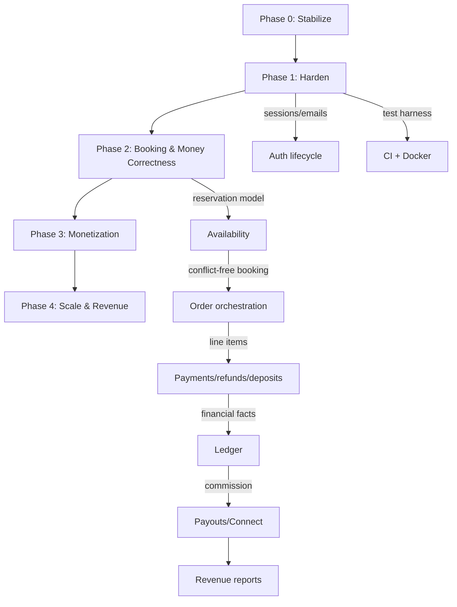

# GearUp — Implementation Plan

> **Product:** GearUp — Sports & Outdoor Gear Rental Marketplace (Backend / API Platform)
> **Document status:** Draft v1.0 — for review
> **Prepared by:** Senior Software Architect / Technical Project Manager
> **Date:** 2026-10-13
> **Sources:** `docs/PROJECT_ANALYSIS.md`, `docs/PRD.md`, `docs/ARCHITECTURE.md`, and the repository (`src/**`, `prisma/schema.prisma`, `package.json`)

This plan operationalizes the approved proposals in `docs/PRD.md` and
`docs/ARCHITECTURE.md`. It follows the existing stack (Express 4 + TS ESM,
Prisma 7 + PostgreSQL, Zod, Stripe, Winston, tsup) and architecture (modular
monolith). **No features are implemented by this document.**

---

## 0. How to Use This Document

### 0.1 Status legend

| Mark | Meaning |
|---|---|
| `[ ]` | Not started |
| `[~]` | In progress / partially complete |
| `[x]` | Complete and verified |

### 0.2 Verification legend (baseline)

| Tag | Meaning |
|---|---|
| **EXISTING** | Implemented in the codebase today (verified) |
| **PARTIAL** | Partially implemented / has gaps |
| **PLANNED** | Not implemented; scheduled in this plan |

### 0.3 Ground rules

- Each task is **small, independently testable**, and maps to a phase in the PRD.
- No task ships without its **tests** and **acceptance criteria** met.
- **Backward compatibility first** for existing routes/contracts.
- **Additive migrations only**; never rewrite existing tables destructively.
- Do not duplicate EXISTING features; do not skip approved proposals.

### 0.4 Validation commands (repo-wide)

| Purpose | Command |
|---|---|
| Install / generate client | `npm ci` (runs `prisma generate` via `postinstall`) |
| Type check | `npm run type-check` |
| Lint | `npm run lint` |
| Format check | `npm run format:check` |
| Build | `npm run build` |
| Prisma migrate (dev) | `npm run prisma:migrate` |
| Prisma migrate (deploy) | `npm run prisma:migrate:deploy` |
| Seed | `npm run prisma:seed` |
| Run tests (to be added) | `npm test` |
| Run tests w/ coverage (to be added) | `npm run test:coverage` |

---

## 1. Verified Baseline (what exists today)

Confirmed by reading the repository on 2026-10-13.

### 1.1 Delivered so far

- [x] `docs/PROJECT_ANALYSIS.md` — code-verified current state & gaps
- [x] `docs/PRD.md` — requirements, priorities, phased roadmap
- [x] `docs/ARCHITECTURE.md` — current + target architecture, ADRs
- [x] `docs/IMPLEMENTATION_PLAN.md` — this document

### 1.2 Platform baseline (EXISTING)

- [x] Express 4 + TypeScript ESM modular monolith; tsup build to `dist/server.js`
- [x] Prisma 7 + `@prisma/adapter-pg`; 6 models / 5 enums; migrations present
- [x] Zod validation middleware; `AppError` taxonomy; global error handler; 404
- [x] JWT auth + DB re-fetch; role middleware; service-layer ownership checks
- [x] Standard response envelope (`ApiResponse`) + pagination meta
- [x] Winston logger (JSON in prod) + morgan; helmet; cors; graceful shutdown
- [x] Stripe PaymentIntent + signed, idempotent webhook
- [x] Atomic stock reservation; guarded rental state machine; rating recalc
- [x] 14 route files / 38 endpoints across auth, gear, rentals, reviews,
      categories, users, payments (+ root handler)

### 1.3 Known gaps / PARTIAL (verified)

- [x] CORS default `origin:'*'` + `credentials:true` (invalid) — `src/app.ts`, `src/config/env.ts`
- [x] `z.coerce.boolean()` coerces `"false"` -> `true` — `src/config/env.ts`, `src/modules/gear/gear.validation.ts`
- [x] No `GET /api/health` (README references it)
- [x] No `.env.example`
- [x] README inaccuracies (review update/delete recalc; stock timing)
- [x] No tests, CI, Docker, or OpenAPI — **addressed in Phase 1** (Vitest harness, GitHub Actions, Dockerfile/compose, OpenAPI at `/api/docs`)
- [x] No rate limiting — **addressed in Phase 1** (`PLAT-4`: Redis-backed, stricter on auth)
- [x] No account lifecycle (refresh token, logout, email verify, password reset) — **addressed in Phase 1** (AUTH-1..3)
- [ ] Availability is stock-only (no date-range conflict detection)
- [ ] No refunds, deposits, payouts, commission, ledger
- [ ] Hardcoded `currency:'usd'`; `PaymentStatus.REFUNDED` never set
- [ ] `SSLCommerz` accepted in enum but rejected at runtime
- [ ] No audit log, no idempotency keys, no webhook dedupe store

---

## 2. Prioritized Feature Backlog (P0–P3)

Priorities follow `PRD.md` §10. Status reflects the verified baseline.

| ID | Feature | Priority | Status | Phase |
|---|---|---|---|---|
| AUTH-FIX-1 | CORS allowlist + boolean coercion fix | P0 | PLANNED | 0 |
| PLAT-FIX-1 | `/api/health` + `.env.example` + README corrections | P0 | PLANNED | 0 |
| PLAT-1 | Test harness (Vitest + Testcontainers) | P0 | PLANNED | 1 |
| PLAT-2 | CI/CD (GitHub Actions) | P0 | PLANNED | 1 |
| PLAT-3 | Docker + docker-compose | P0 | PLANNED | 1 |
| AUTH-1 | Refresh tokens + sessions + logout | P0 | PLANNED | 1 |
| AUTH-2 | Email verification | P0 | PLANNED | 1 |
| AUTH-3 | Password reset | P0 | PLANNED | 1 |
| NOTIF-1 | Email delivery (Nodemailer/SMTP) | P0 | PLANNED | 1 |
| PLAT-4 | Rate limiting (Redis) | P0 | PLANNED | 1 |
| PLAT-5 | Request IDs + Sentry + readiness probe | P0 | PLANNED | 1 |
| PLAT-6 | OpenAPI generated from Zod | P1 | PLANNED | 1 |
| AUTH-4 | Audit log foundation | P1 | PLANNED | 1 |
| AVAIL-1 | Date-range availability model | P0 | PLANNED | 2 |
| AVAIL-2 | Availability endpoint + blocks | P0 | PLANNED | 2 |
| AVAIL-3 | Double-booking prevention | P0 | PLANNED | 2 |
| RENT-1 | Order line items & pricing breakdown | P0 | PLANNED | 2 |
| PAY-1 | Deposits (manual capture) | P0 | PLANNED | 2 |
| PAY-2 | Refunds + `charge.refunded` webhook | P0 | PLANNED | 2 |
| PAY-3 | Idempotency keys | P1 | PLANNED | 2 |
| PLAT-7 | Configurable currency | P1 | PLANNED | 2 |
| PAY-4 | Tax & invoices | P1 | PLANNED | 2 |
| PAY-5 | Payouts via Stripe Connect | P0 | PLANNED | 3 |
| PAY-6 | Immutable ledger + commission | P0 | PLANNED | 3 |
| PAY-7 | Provider earnings + KYC gating | P0 | PLANNED | 3 |
| DISP-1 | Dispute workflow | P1 | PLANNED | 3 |
| ADMIN-1 | Revenue reports (admin) | P1 | PLANNED | 3 |
| SCALE-1 | Redis caching + cursor pagination | P2 | PLANNED | 4 |
| PLAT-8 | Object storage uploads | P2 | PLANNED | 4 |
| REV-1 | Provider subscriptions / featured listings | P2 | PLANNED | 4 |
| NOTIF-2 | In-app notifications | P2 | PLANNED | 4 |
| MSG-1 | Customer–provider messaging | P3 | PLANNED | 4 |
| ADMIN-2 | Granular admin roles | P2 | PLANNED | 4 |

---

## 3. Feature Dependencies & Recommended Order



**Hard dependencies (must precede):**

- Test harness + CI (Phase 1) before any high-risk business change.
- Email/SMTP (Phase 1) before verification/reset (AUTH-2/3).
- Refresh/session model (AUTH-1) before auth hardening is considered done.
- Availability/reservations (Phase 2) before correct multi-item booking.
- Line items + idempotency (Phase 2) before refunds/deposits (PAY-1/2).
- Immutable ledger (Phase 3) before payouts/commission/reports.
- Stripe Connect onboarding + KYC (Phase 3) before provider payouts.

**Recommended order (top-to-bottom within each phase):** infra/testing → auth →
correctness → money → monetization → scale.

---

---

## 4. Implementation Phases

Each phase lists objective, deliverables, required changes, tasks, tests,
acceptance criteria, and validation. Phases may run partly in parallel where no
hard dependency exists.

---

### Phase 0 — Stabilize (P0)

**Objective:** Remove verified defects and gaps that block production and break
documented behavior. No schema changes, no new features.

**Deliverables:** corrected CORS config, fixed boolean validation, health
endpoint, `.env.example`, corrected README.

**Database changes:** none.

**API changes:** add `GET /api/health`.

**Security changes:** restrict CORS to an explicit allowlist; never combine `*`
with credentials.

**Architecture changes:** none (config + docs only).

**Tasks**

- [x] FIX: CORS — replace wildcard with `CORS_ORIGIN` allowlist; split dev/prod defaults (`src/config/env.ts`, `src/app.ts`)
- [x] FIX: env boolean parsing — replace `z.coerce.boolean()` with an explicit `"true"/"false"` transform (`src/config/env.ts`)
- [x] FIX: gear boolean query validation — same explicit boolean handling (`src/modules/gear/gear.validation.ts`)
- [x] ADD: `GET /api/health` returning `{ success, message, data: { status, uptime } }` (`src/app.ts`)
- [x] ADD: `.env.example` with every required var (no secrets)
- [x] FIX: README inaccuracies (health route, review lifecycle, stock timing)
- [x] VERIFY: build + type-check + lint pass

**Testing requirements**

- [x] Unit: boolean schema accepts `"true"`/`"false"` and rejects others
- [x] Integration: `GET /api/health` returns 200 and expected shape
- [x] Config: CORS rejects a disallowed origin in production mode

**Acceptance criteria**

- [x] `GET /api/health` returns 200 with the documented shape
- [x] CORS reflects only allowlisted origins; no `*` with credentials
- [x] `isAvailable=false` query correctly filters (no `"false"` -> `true`)
- [x] `.env.example` lists all required vars; app boots from a copy of it
- [x] README matches actual behavior
- [x] `npm run build && npm run type-check && npm run lint` pass

**Validation commands**

```powershell
npm ci
npm run type-check; npm run lint; npm run build
# smoke test (with server running)
Invoke-RestMethod http://localhost:5000/api/health
```

---

### Phase 1 — Harden (P0 baseline)

**Objective:** Establish a production baseline: automated tests, CI/CD, container
parity, account lifecycle, rate limiting, observability, and API docs.

**Deliverables:** test harness, CI pipeline, Docker images, Redis, auth lifecycle
(refresh/verify/reset), Nodemailer emailing, request IDs + Sentry, OpenAPI, audit
log foundation.

**Database changes (additive):**
`Session`, `VerificationToken`, `User.emailVerifiedAt`, `AuditLog`, indexes.

**API changes:**
`POST /auth/refresh`, `/auth/logout`, `/auth/logout-all`,
`/auth/verify-email`, `/auth/resend-verification`, `/auth/forgot-password`,
`/auth/reset-password`, `GET /api/health/ready`, `GET /api/docs`.

**Security changes:** short-lived access tokens; rotating revocable refresh
tokens (hashed); rate limiting; email verification gating; audit logging;
helmet tuning; request correlation.

**Architecture changes:** introduce Redis (sessions/rate-limit/cache) and a mail
abstraction (SMTP via Nodemailer); add Sentry.

**Tasks**

- [x] PLAT-1: add Vitest + `supertest` + Testcontainers (Postgres) harness; `npm test` script
- [x] PLAT-2: GitHub Actions workflow (install, generate, type-check, lint, test, build)
- [x] PLAT-3: multi-stage `Dockerfile` + `docker-compose.yml` (api, postgres, redis)
- [x] AUTH-1: `Session`/`RefreshToken` model + migration; issue refresh on login; `refresh`/`logout`/`logout-all` endpoints; rotate on refresh
- [x] AUTH-1: shorten access-token TTL; keep DB re-fetch on protected routes
- [x] AUTH-2: `VerificationToken` (EMAIL_VERIFY) + verify/resend endpoints; gate transacting on `emailVerifiedAt`
- [x] AUTH-3: `VerificationToken` (PASSWORD_RESET) + forgot/reset endpoints; invalidate sessions on reset
- [~] NOTIF-1: Nodemailer/SMTP abstraction + templates (verify + reset done; order-event templates pending)
- [x] PLAT-4: rate limiting middleware (Redis-backed; stricter on auth/payment)
- [x] PLAT-5: request-ID middleware; Sentry wiring in error middleware; `GET /api/health/ready` (DB check)
- [x] PLAT-6: derive OpenAPI 3 from Zod schemas; serve Swagger UI at `/api/docs`
- [~] AUTH-4: `AuditLog` model + helper (done); logging wired for auth events — privileged admin actions pending

**Testing requirements**

- [~] Unit: token/session lifecycle (issue, rotate, revoke, expiry) — covered by integration; dedicated unit tests pending
- [x] Integration: full auth flows (register→verify→login→refresh→logout→reset)
- [~] Integration: rate limiter returns 429 past threshold — verified manually via compose; automated test pending
- [~] Integration: readiness probe reflects DB connectivity — verified manually via compose; automated test pending
- [ ] Integration: audit entries written for privileged actions
- [x] Contract: OpenAPI schema generation succeeds and matches routes

**Acceptance criteria**

- [x] All new auth endpoints covered by passing integration tests
- [x] Login returns a short access token + rotating refresh token
- [x] Revoked/rotated refresh tokens are rejected; reset invalidates sessions
- [x] Unverified users cannot create orders/payments
- [x] Auth endpoints rate-limited; 429 returned under load
- [~] Every response carries `x-request-id`; 5xx errors appear in Sentry — middleware wired; live Sentry DSN unverified
- [~] CI green on PR; Docker compose brings up api+db+redis locally — compose verified locally; CI pending first push
- [x] `/api/docs` renders generated OpenAPI

**Validation commands**

```powershell
npm test
npm run type-check; npm run lint; npm run build
docker compose up -d; docker compose exec api npm run prisma:migrate:deploy
```

---

---

### Phase 2 — Booking & Money Correctness (P0)

**Objective:** Make rentals date-correct and financially complete: availability
by date range, order line items, deposits, refunds, idempotency, and configurable
currency.

**Deliverables:** availability module, pricing/line items, deposit hold/release,
refunds webhook, idempotency keys, currency config, tax/invoices.

**Database changes (additive):**
`GearAvailabilityBlock`, date-scoped reservation (or `OrderItem`),
`OrderLineItem`, `Deposit`, `Refund`, `IdempotencyKey`; `currency` fields.

**API changes:**
`GET /gear/:id/availability`, `POST/DELETE /gear/:id/blocks`,
`GET /orders/:id/breakdown`, `POST /payments/refund` (admin/provider per policy),
`POST /orders` accepts `Idempotency-Key`,
`PATCH /rentals/:id/cancel` (customer) / `PATCH /provider/orders/:id/cancel`
(provider) / `PATCH /admin/rentals/:id/status` (admin override).

**Security changes:** restrict refunds by policy + ownership; validate money
boundaries; ensure no client-controlled amounts.

**Architecture changes:** introduce `availability` and `pricing` domain modules;
extend `payments`; add idempotency helper.

**Decisions (confirmed):**

- Tax/invoicing (2F) is in scope but implemented **last** (Stripe Tax + emailed
  receipt; no custom PDF).
- Availability concurrency uses a **Postgres advisory xact lock** keyed on
  `gearId` inside the booking transaction.
- Platform fee and deposit are **global env defaults**
  (`PLATFORM_FEE_PERCENT`, `DEPOSIT_PERCENT`); per-gear overrides deferred.
- Cancellation refunds are **time-tiered** and env-configurable: a full
  charge refund when cancelling at least `CANCELLATION_FULL_REFUND_HOURS`
  before the start date, otherwise `CANCELLATION_PARTIAL_REFUND_PERCENT`%
  of the charge, and nothing once the rental has started. The security
  deposit hold is always released on cancel/return. Provider- and
  admin-initiated cancellations always refund the full charge. Customers
  (own orders), providers (orders on their gear) and admins (override) may
  cancel.
- Security deposit is held with a **separate Stripe manual-capture
  PaymentIntent** (authorize, not charge); the rental charge excludes the
  deposit. Released (voided) on a clean return, captured (partly) on damage.
  Refunds are admin-issued, server-priced, and idempotent.
- Plan doc updated before coding; one commit per sub-phase.

**Sub-phases**

**2A — Availability engine & double-booking prevention**
- [x] AVAIL-1: model `GearAvailabilityBlock`; `RESERVING_STATUSES` constant; migration + index
- [x] AVAIL-2: `GET /gear/:id/availability?start&end` + provider block CRUD (`POST/DELETE /provider/gear/:id/blocks`)
- [x] AVAIL-3: transactional overlap check under Postgres advisory xact lock; `409` on conflict
- [x] AVAIL-4: pure `rangesOverlap([s,e))` util (half-open) + unit tests

**2B — Pricing breakdown, line items & configurable currency**
- [x] RENT-1: `OrderLineItem` model + snapshot breakdown columns (`subtotal`, `serviceFee`, `depositAmount`, `taxAmount`, `currency`)
- [x] RENT-2: Decimal-safe pricing util (fees/deposit/rounding) from `PLATFORM_FEE_PERCENT`/`DEPOSIT_PERCENT`
- [x] PLAT-7: configurable `CURRENCY` (default `USD`); remove hardcoded `'usd'`; persist on order + payment
- [x] RENT-3: `GET /rentals/:id/breakdown` (owner/admin scoped)

**2C — Idempotency**
- [x] PAY-3: `IdempotencyKey` model + middleware on `POST /rentals` and `POST /payments/create` (replay; `409` on body mismatch)

**2D — Deposits & refunds**
- [x] PAY-1: deposit authorize at booking (manual capture) + release on clean return; capture on damage
- [x] PAY-2: refund service (full/partial) + Stripe `charge.refunded` webhook; set `REFUNDED`/`PARTIALLY_REFUNDED`
- [x] PAY-5: damage/late fees recorded as line items

**2E — Cancellation policy & status timing**
- [x] RENT-4: extend transitions (provider-cancel, admin-override, cancel from `CONFIRMED`/`PAID` per policy)
- [x] RENT-5: date-aware release of reservation + deposit on cancel/return (replaces blunt stock increment)

**2F — Tax & invoices (last)**
- [x] PAY-4: Stripe Tax on the charge + emailed receipt; tax persisted as a line item

**Cross-cutting**
- [x] Remove/guard `SSLCommerz` (reject explicitly or drop from accepted methods)

**Testing requirements**

- [x] (2A) Unit: overlap detection (adjacent, exact, nested ranges)
- [x] (2B) Unit: pricing breakdown math and rounding (Decimal)
- [x] (2C) Unit/Integration: idempotency replay returns identical response, no double effect
- [x] (2A) Integration: concurrent booking attempts — exactly one succeeds per window
- [x] (2D) Integration: deposit authorize → release; damage → capture
- [x] (2D) Integration: refund (full/partial) updates payment + order consistently
- [x] (2D) Integration: `charge.refunded` webhook idempotent (no double refund)
- [x] (2A/2D) Stripe interactions mocked in tests (no live key required)
- [x] (2E) Unit: cancellation refund tiers (full/partial/none) incl. boundaries
- [x] (2E) Integration: customer cancel refunds per policy + releases deposit
- [x] (2E) Integration: provider/admin cancel always refunds in full
- [x] (2F) Integration: Stripe Tax on the rental charge (deposit excluded) persisted as a `TAX` line item + order totals; tax-free when no billing address
- [x] (2F) Integration: itemized receipt emailed once on `payment_intent.succeeded` (no duplicate on redelivery)

**Acceptance criteria**

- [ ] No double-booking for overlapping windows under concurrent load
- [ ] Order totals itemized and reproducible; Decimal-safe
- [x] Deposits authorized/released/captured per policy; no orphaned holds
- [ ] Refunds supported (full/partial) and reflected in payment status
- [ ] Duplicate order/payment requests with same key have no double effect
- [ ] Currency configurable; hardcoded `usd` removed
- [x] Tax line present and receipt emailed on completion

**Validation commands**

```powershell
npm test
npm run prisma:migrate
npm run type-check; npm run lint; npm run build
# Stripe webhook replay (test mode)
stripe listen --forward-to localhost:5000/api/payments/webhook
```

---

### Phase 3 — Monetization (P0/P1)

**Objective:** Turn transactions into revenue: Stripe Connect payouts, immutable
ledger, platform commission, provider earnings, KYC gating, disputes, and admin
reports.

**Deliverables:** payouts module, ledger, commission rules, provider onboarding +
KYC status, earnings endpoint, dispute workflow, revenue reports, payout worker.

**Database changes (additive):**
`ProviderAccount`, `Payout`, `LedgerEntry`, `CommissionRule`, `Dispute`,
`WebhookEvent`.

**API changes:**
`POST /provider/connect/onboard`, `GET /provider/earnings`,
`GET /provider/payouts`, `POST /disputes`,
`PATCH /admin/disputes/:id/resolve`, `GET /admin/revenue`.

**Security changes:** KYC-gated payouts; commission computed server-side;
audit all financial admin actions; idempotent payout execution.

**Architecture changes:** introduce `payouts` + `ledger` modules; background
**job queue + worker** for payout execution and reconciliation; immutable
append-only ledger.

**Tasks**

- [ ] PAY-5: Stripe Connect account creation + onboarding link; store on `ProviderAccount`
- [ ] PAY-7: gate payouts on `kycStatus`/`payoutsEnabled`; expose provider earnings
- [ ] PAY-6: `LedgerEntry` (append-only) written on payment/refund/commission
- [ ] PAY-6: `CommissionRule` + server-side commission calc at settlement
- [ ] PAY-5: payout worker (queue) executes idempotent Stripe transfers after hold
- [ ] DISP-1: dispute workflow (open → evidence → resolve; adjust ledger)
- [ ] ADMIN-1: admin revenue reports (GMV, commission, refunds, payouts)
- [ ] Webhook dedupe store (`WebhookEvent`) for all relevant Stripe events
- [ ] Reconciliation job compares Stripe objects to ledger

**Testing requirements**

- [ ] Unit: commission math per rule + edge cases (refund, partial, rounding)
- [ ] Unit: ledger is append-only (no updates/deletes in code paths)
- [ ] Integration: Connect onboarding + payout eligibility gating (KYC states)
- [ ] Integration: payout idempotency (retry does not double-pay)
- [ ] Integration: refund/dispute adjusts ledger and provider earnings correctly
- [ ] Integration: revenue report totals match ledger

**Acceptance criteria**

- [ ] Providers can onboard to Stripe Connect; KYC status tracked
- [ ] Payouts blocked until KYC/payouts enabled; executed after return + hold
- [ ] Commission deducted correctly; ledger reconciles with Stripe
- [ ] Disputes resolve and adjust the ledger (no direct mutation of history)
- [ ] Admin revenue report matches ledger sums
- [ ] All payout/dispute actions audited

**Validation commands**

```powershell
npm test
npm run prisma:migrate
# Stripe Connect test-mode onboarding / transfer
stripe trigger transfer.created
```

---

### Phase 4 — Scale & Revenue Expansion (P2/P3)

**Objective:** Improve scale, performance, and incremental revenue streams.

**Deliverables:** Redis caching + cursor pagination, object-storage uploads,
subscriptions/featured listings, in-app notifications, messaging, granular admin
roles.

**Database changes (additive):**
`Subscription`/`Plan`, `FeaturedListing`, `Notification`, `Conversation`/
`Message`, admin role fields.

**API changes:**
cursor pagination on list endpoints, `POST /uploads/sign`,
subscription/featured endpoints, `GET /notifications`, messaging endpoints.

**Security changes:** granular admin roles; signed upload URLs; subscription
entitlement checks.

**Architecture changes:** cache layer; upload service; Stripe Billing; optional
read replica for reporting.

**Tasks**

- [ ] SCALE-1: Redis caching for hot reads + cursor pagination on large lists
- [ ] PLAT-8: object-storage signed uploads; migrate image handling
- [ ] REV-1: subscriptions/featured listings (Stripe Billing) + entitlements
- [ ] NOTIF-2: in-app notification feed + read/unread
- [ ] MSG-1: customer–provider conversations (P3)
- [ ] ADMIN-2: granular admin roles (SUPER_ADMIN/MODERATOR/FINANCE) + audit
- [ ] Optional: read replica for analytics/reporting

**Testing requirements**

- [ ] Integration: cache hit/miss + invalidation on writes
- [ ] Integration: cursor pagination is stable across inserts
- [ ] Integration: upload signing rejects unauthorized types/sizes
- [ ] Integration: subscription entitlement gates features
- [ ] Integration: granular admin roles enforce capability boundaries

**Acceptance criteria**

- [ ] Hot reads served from cache with correct invalidation
- [ ] Large lists paginate via cursor with no duplicates/skips
- [ ] Uploads stored in object storage; no local-disk dependency
- [ ] Subscriptions/featured listings charge and gate correctly
- [ ] Admin capabilities enforced by role; all actions audited

**Validation commands**

```powershell
npm test
npm run type-check; npm run lint; npm run build
```

---

---

## 5. Cross-Cutting Concerns

### 5.1 Testing strategy

| Level | Scope | Tooling | Introduced |
|---|---|---|---|
| Unit | Pure logic (pricing, overlap, tokens, commission) | Vitest | Phase 1 |
| Integration | Route + service + real Postgres | Vitest + supertest + Testcontainers | Phase 1 |
| Contract | OpenAPI matches implemented routes | zod-to-openapi + schema assertions | Phase 1 |
| Webhook | Stripe event handling + idempotency | Stripe fixtures/test clock | Phase 2 |
| Concurrency | Race behavior (booking, payout) | Parallel integration tests | Phase 2–3 |

**Rules:** real Postgres via Testcontainers (no mocking the DB); each risky
business rule gets a test before merge; coverage gate ratified in Phase 1
(suggested: >= 70% lines on `src/modules/**`).

### 5.2 CI/CD pipeline (Phase 1+)

- [ ] On PR: install → `prisma generate` → type-check → lint → test → build
- [ ] On main: build + push image; run `prisma migrate deploy` on release
- [ ] Migrations tested in staging before production
- [ ] Branch protection requires green CI

### 5.3 Environments

| Env | DB | Stripe | Purpose |
|---|---|---|---|
| development | local Postgres/Redis | test keys | local dev |
| staging | isolated Postgres/Redis | test keys | pre-prod validation |
| production | managed Postgres/Redis | live keys | customers |

### 5.4 Database migration policy

- Additive only; nullable-then-backfill-then-constrain.
- One migration per logical change; reviewed before apply.
- Drift check via `prisma migrate diff` in CI (Phase 1+).

### 5.5 Definition of Done (every task)

- [ ] Code implements the requirement; no scope creep
- [ ] Tests added/updated and passing
- [ ] `npm run type-check`, `npm run lint`, `npm test`, `npm run build` pass
- [ ] Docs updated (README/OpenAPI) where behavior/contract changes
- [ ] Security/ownership rules respected; no secrets committed
- [ ] Audit logging added where the action is privileged

---

## 6. Risk Register

| ID | Risk | Likelihood | Impact | Mitigation |
|---|---|---|---|---|
| R1 | Money bugs (double charge/refund/payout) | Med | High | Idempotency keys, immutable ledger, webhook dedupe, tests |
| R2 | Booking race conditions (double-book) | Med | High | Transactional overlap check + concurrency tests |
| R3 | Stripe Connect/KYC delays | Med | High | Start onboarding early in Phase 3; manual fallback |
| R4 | Migration issues on existing data | Med | Med | Additive migrations, staging, backfills, backups |
| R5 | Test harness setup cost | Low | Med | Testcontainers from Phase 1; standard patterns |
| R6 | Scope creep / phase overlap | Med | Med | Enforce phase gates + DoD; PR-sized tasks |
| R7 | Vercel serverless limits for workers | Low | Med | Run worker on persistent process/container |
| R8 | Currency/tax complexity | Med | Med | Delegate to Stripe Tax; default single currency first |

**External dependencies:** Stripe (Payments/Connect/Tax/Billing), SMTP provider,
Redis, object storage, Sentry, CI runner.

---

## 7. Progress Dashboard

Update marks as work proceeds.

| Phase | Objective | Status |
|---|---|---|
| 0 | Stabilize (bug/config fixes) | `[x]` |
| 1 | Harden (tests, CI, auth, observability) | `[~]` |
| 2 | Booking & money correctness | `[~]` |
| 3 | Monetization (payouts, ledger, commission) | `[ ]` |
| 4 | Scale & revenue expansion | `[ ]` |

### 7.1 Milestone gates

- [x] **M0:** Phase 0 complete; build/type/lint green; health endpoint live
- [~] **M1:** test harness + GitHub Actions workflow + Docker/Redis + auth lifecycle + rate limiting + request IDs + Sentry wiring + OpenAPI done and verified locally. Pending before M1 is fully met: first green CI run on GitHub, live Sentry DSN confirmation, order-event email templates, admin audit logging, dedicated token unit tests.
- [ ] **M2:** Phase 2 complete; no double-booking; refunds/deposits/idempotency
- [ ] **M3:** Phase 3 complete; payouts + ledger reconcile; KYC gating enforced
- [ ] **M4:** Phase 4 complete; caching/uploads/subscriptions/roles

### 7.2 Program-level acceptance

- [ ] All Existing features preserved (no regressions)
- [ ] All PARTIAL gaps closed per phase
- [ ] All approved proposals in `PRD.md`/`ARCHITECTURE.md` implemented
- [ ] Zero known P0/P1 defects open
- [ ] Open questions in `PRD.md` §13.3 resolved

---

## 8. Recommended Starting Point

**Start with Phase 0, then Phase 1.**

1. **Phase 0 (fast, low risk, unblocks correctness):**
   CORS allowlist, boolean coercion fix, `/api/health`, `.env.example`, README.
   No schema changes; immediately testable.
2. **Phase 1 (baseline before high-risk work):**
   test harness (Vitest + Testcontainers), CI, Docker/Redis, then auth lifecycle,
   rate limiting, request IDs + Sentry, OpenAPI.

**Do not begin Phase 2+ until M1 is met** — booking/money changes are high-risk
and must be backed by tests and CI.

**Open decisions still required before Phase 3 design finalizes:**
commission rate/model, deposit model, payout cadence, KYC approach (see
`PRD.md` §13.3). Phase 0–2 can proceed without them.

---

## 9. Appendix — Phase ↔ PRD/Analysis Traceability

| Phase | PRD sections | Analysis refs |
|---|---|---|
| 0 | §9, §13 | §13 (verified bugs), §11 (config) |
| 1 | §4, §5, §6, §7, §8 | §7 (logging), §10 (config), §13 |
| 2 | §5, §6, §10 | §13 (availability, refunds, currency) |
| 3 | §5, §6, §10, §11 | §13 (payouts, ledger, commission) |
| 4 | §5, §6, §7, §9 | §7, §9 |

### 9.1 Change log

| Version | Date | Notes |
|---|---|---|
| 1.0 | 2026-10-13 | Initial phased implementation plan from verified baseline + PRD + architecture |
| 1.1 | 2026-10-13 | Phase 1 (Harden) implemented and locally verified: test harness, CI workflow, Docker/compose, auth lifecycle (refresh/verify/reset), Redis-backed rate limiting, request IDs + Sentry wiring, OpenAPI/Swagger, audit foundation |
| 1.2 | 2026-10-14 | Phase 2 split into sub-phases 2A–2F; decisions recorded (Stripe Tax last, advisory xact lock for availability, global env fee/deposit defaults) |
| 1.3 | 2026-10-14 | Sub-phase 2A complete: `GearAvailabilityBlock` + migration, half-open `rangesOverlap` util, `GET /gear/:id/availability`, provider block CRUD, advisory-lock overlap check in `createRentalOrder` (global stock counter retired); unit + integration tests green |
| 1.4 | 2026-10-14 | Sub-phase 2B complete: `OrderLineItem` + order breakdown columns (`subtotal`/`serviceFee`/`depositAmount`/`taxAmount`/`currency`) and `Payment.currency` (additive migration + backfill), Decimal-safe `pricing` util from `PLATFORM_FEE_PERCENT`/`DEPOSIT_PERCENT`, configurable `CURRENCY` (removed hardcoded `usd`), `GET /rentals/:id/breakdown`; unit + integration tests green |
| 1.5 | 2026-10-14 | Sub-phase 2C complete: `IdempotencyKey` model + opt-in `Idempotency-Key` middleware on `POST /rentals` and `POST /payments/create` (replay with `Idempotency-Replayed` header, `409` on body mismatch or in-flight duplicate, releases key on 5xx); deterministic body hashing; unit + integration tests green |
| 1.6 | 2026-10-14 | Sub-phase 2D complete: `Deposit` + `Refund` models and `DepositStatus`/`RefundStatus` enums + `PaymentStatus.PARTIALLY_REFUNDED` (additive migration). Deposit held via Stripe manual capture (rental charge excludes deposit); released on clean return, captured (partially) on damage with a `DAMAGE_FEE` line item. Admin `POST /payments/refund` (full/partial, server-derived amounts, idempotent) + idempotent `charge.refunded` reconciliation; unit + integration tests green (Stripe mocked) |
| 1.7 | 2026-10-14 | Sub-phase 2E complete: time-tiered cancellation policy (`CANCELLATION_FULL_REFUND_HOURS`/`CANCELLATION_PARTIAL_REFUND_PERCENT`) + `cancellation` util; transitions extended (`CONFIRMED`/`PAID` -> `CANCELLED`); actor-aware cancel (customer/provider/admin) releasing the deposit hold and refunding per policy (provider/admin always full); provider `PATCH /provider/orders/:id/cancel`; admin override `PATCH /admin/rentals/:id/status`; unit + integration tests green |
| 1.8 | 2026-10-14 | Sub-phase 2F complete (Phase 2 done): optional `billingAddress` on `POST /payments/create` drives the Stripe Tax Calculation API on the rental charge (`subtotal + serviceFee`; deposit excluded), persisted as a `TAX` line item + `order.taxAmount`/`totalAmount` (reconciled, not duplicated, on re-initiation); itemized receipt emailed best-effort on `payment_intent.succeeded`; SSLCommerz explicitly rejected (`guard`); unit + integration tests green (Stripe + mailer mocked) |

---

> **No features are implemented by this document.** This plan is the execution
> roadmap for the approved proposals and is subject to review/approval.
